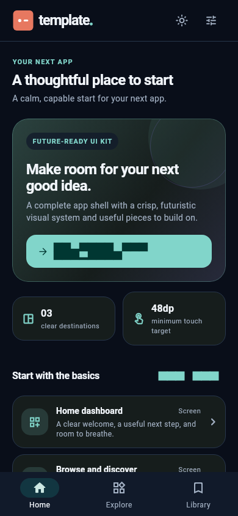

# Template App

A reusable Flutter starter for small Android apps. It follows the calm, focused feel of the nearby **morse** app, with a cleaner futuristic layer: a midnight base, restrained ion and violet highlights, quiet tonal surfaces, generous touch targets, light and dark themes, and three persistent destinations.

The example app is intentionally generic. It demonstrates a home dashboard, a filterable set of building blocks, a saveable library, and practical theme settings. The saved items and theme choices are in-memory demo state; connect them to storage when a future app needs persistence.

## Design system

- **Palette:** midnight `#090E19`, ion seed `#19B8AA`, violet `#8D78F6`, and a soft blue-white light surface `#F3F6FA`. Material tonal roles adapt the palette for each theme.
- **Navigation:** Home, Explore, and Library are the primary destinations. Settings opens in a scrollable popup sheet from the top bar; the app shell uses an `IndexedStack` to preserve destination state.
- **Layout:** compact brand bar, one clear action per section, generous whitespace, consistent rounded surfaces, and subtle outlines.
- **Futuristic detail:** a restrained accent gradient and orbital ring give the home surface depth; glow and color stay secondary to legible content.
- **Responsive behavior:** content is centered and capped at 760 dp on wide screens, while remaining scrollable on phones.
- **Dependencies:** `url_launcher` is the only third-party runtime plugin; it opens the configured privacy-policy URL. There is no app account, backend, analytics, or data connection.

## Visual principles

Use these defaults when adapting the template:

- Establish hierarchy with spacing, readable type, and a small number of surface levels.
- Give each color a consistent semantic role. Use a bright accent for actions or selection, not as decoration everywhere; verify both light and dark palettes.
- Keep text and controls distinct from their backgrounds. Aim for at least 4.5:1 contrast for regular text, and make interactive targets at least 48 dp.
- Pair color with labels, shape, or icons so color is never the only signal.
- Use motion briefly to explain a change, and keep navigation and dismiss gestures predictable.
- Treat futuristic styling as a finishing layer: restrained glow, subtle gradients, and clean surfaces around functional content.

These defaults follow the [Android accessibility guidance](https://developer.android.com/design/ui/mobile/guides/foundations/accessibility), [Android color guidance](https://developer.android.com/design/ui/mobile/guides/styles/color), and Apple's guidance on [design principles](https://developer.apple.com/design/human-interface-guidelines/design-principles) and [purposeful motion](https://developer.apple.com/design/human-interface-guidelines/motion).

## Commercial use and licenses

**Rule for every app made from this template:** use only dependencies, icons, fonts, images, and other assets whose exact license permits commercial use. Before adding or updating anything—including transitive pub packages, Android/Gradle plugins, or copied assets—check the resolved version's license and attribution/notice requirements. Reject non-commercial, unclear, or unlicensed material. Keep `THIRD_PARTY_NOTICES.md` current, retain required license texts and notices, and expose required attributions in the app's About or open-source licenses screen. Recheck `pubspec.lock`, Gradle plugins, and bundled assets before each release; “free” or “open source” alone is not proof of commercial permission.

The current dependency and icon audit is recorded in [`THIRD_PARTY_NOTICES.md`](THIRD_PARTY_NOTICES.md). Flutter supplies the app's Material icon font through `uses-material-design`; its exact SDK-supplied font license is included in that audit. The App identity card has a compact open-source licenses icon backed by Flutter's license page and a Privacy policy button. Set `AppConfig.privacyPolicyUrl` to the policy's published URL before shipping a derived app. Roboto and Material Icons copies under `test/fonts/` are used only by the screenshot test and are not app assets.

## Phone-size preview



This is a Flutter-rendered phone-size preview without Android system bars. Regenerate it with:

```sh
flutter test --update-goldens --plain-name 'home screen phone-size preview'
```

The preview test loads Roboto and Material Icons from `test/fonts/`; those copies are test-only and are not bundled as app assets.

## Where to customize

| Change | File(s) |
| --- | --- |
| Product name, brand wordmark, tagline, displayed package/version | `lib/app/app_config.dart` |
| Main palette, light/dark surfaces, Material 3 theme | `lib/theme/app_theme.dart` |
| Accent choices shown in Settings | `lib/app/app_config.dart` (`accentOptions`) |
| Top-level destination labels and icons | `lib/app/app_config.dart` (`AppTab`, `appTabs`) |
| Which screen belongs to each destination, and the Settings popup | `lib/app/app_shell.dart` |
| Example content and detail copy | `lib/app/feature_catalog.dart` |
| Individual screen layouts | `lib/screens/` |
| Shared app bar, page layout, and feature card | `lib/widgets/` |
| Launcher and title-bar brand mark | `android/app/src/main/res/drawable/ic_launcher.xml`, `android/app/src/main/res/mipmap-*/ic_launcher.png`, `lib/widgets/app_brand_icon.dart` (keep the shared mark and color in sync; regenerate Android bitmaps with `java tool/generate_android_launcher_icons.java`) |
| Privacy policy destination | `lib/app/app_config.dart` (`privacyPolicyUrl`) |
| Android package identity | `android/app/build.gradle.kts`, `android/app/src/main/kotlin/com/example/template_app/MainActivity.kt`, `lib/app/app_config.dart` |
| Version and Android build number | `pubspec.yaml` (`version: name+build`) |

### Reuse checklist

1. Set `productName`, `brandName`, and `tagline` in `app_config.dart`; update the Android manifest label and keep the title-bar painter and launcher vector in sync.
2. Replace the ion and violet constants in `app_theme.dart`. Add or remove preview colors in `accentOptions`.
3. Rename the `AppTab` entries and `appTabs` labels/icons. Add, remove, or replace the matching widgets in the `screens` map in `app_shell.dart`. Keep primary destinations here; Settings can remain a top-bar popup.
4. Replace the sample catalog in `feature_catalog.dart` with the next app's content, or remove Explore and Library if they do not fit.
5. Choose a unique Android application ID before publishing. Change both Gradle `namespace` and `applicationId`, update `AppConfig.packageId`, and rename the Kotlin package declaration and directory to match. A published app cannot change its application ID and remain the same Play Store app.
6. Update `android:label` and both brand-mark renderings for the installed app identity.
7. Set `AppConfig.privacyPolicyUrl` to the published policy, for example a GitHub `blob/main/PRIVACY.md` URL.
8. Increment `version` in `pubspec.yaml` for each install/update. The number after `+` becomes Android's monotonically increasing `versionCode`.

The default application ID is `com.example.template_app`, which is a placeholder. Do not publish under it; replace it with an ID you control.

## Build and verify

Use Flutter 3.47.7 or newer with Dart 3.13.5 or newer, Android SDK, and Java 17.

```sh
flutter pub get
flutter analyze
flutter test
flutter build apk --debug --target-platform android-arm64
flutter build appbundle --release
python3 tool/package_android_artifacts.py
```

Outputs:

- Debug APK: `build/app/outputs/flutter-apk/app-debug.apk` — ARM64 only, signed with Android's debug key for local install/testing. This keeps the phone download much smaller than a universal APK. For other device architectures, use `flutter build apk --debug --split-per-abi` and choose the matching APK.
- Release AAB: `build/app/outputs/bundle/release/app-release.aab` — signed with the release key configured below.
- `python3 tool/package_android_artifacts.py` copies the APK and packages the AAB for download under `build/deliverables/`, using the current version in `pubspec.yaml` in each filename. It writes `SHA256SUMS.txt` for the APK and AAB ZIP; after downloading those three files into one folder, run `sha256sum -c SHA256SUMS.txt` to check the downloads. The AAB ZIP also contains a checksum for the AAB itself.

The app is Android-only. There is no saved deployment target; build the APK/AAB locally and install or upload them through your usual Android workflow.

## Android signing

`android/app/build.gradle.kts` reads `android/key.properties`. When that file exists, release APK/AAB builds use the configured release key. Without it, Gradle falls back to the debug key so local builds still work; that fallback is not a Play Store upload key.

This workspace has a generated local release key at `android/app/template-upload.jks` and its ignored credentials in `android/key.properties`. The AAB built from this workspace is signed with that key. Both files are excluded by `android/.gitignore`; they are not source files. Back them up securely if you need to publish updates to this exact package ID. Losing the key prevents signing updates with the same certificate.

For every new app, create a unique upload key and keep its credentials safe. Do not reuse this template's local key across unrelated apps. Example:

```sh
keytool -genkeypair -v \
  -keystore android/app/upload-keystore.jks \
  -storetype JKS -keyalg RSA -keysize 2048 -validity 10000 \
  -alias upload
```

Create `android/key.properties` (ignored by Git) with the values you chose:

```properties
storePassword=<keystore password>
keyPassword=<key password>
keyAlias=upload
storeFile=upload-keystore.jks
```

`storeFile` is relative to `android/app`. Keep both the `.jks` file and `key.properties` private and backed up. Never put passwords or a signing key in source control. Release signing should be configured before building an app for Play; the template's debug fallback is only for local checks.

## App behavior

The Explore tab filters example screens, components, and patterns, including contrast, comfortable controls, tonal depth, purposeful motion, and focused secondary settings. Save buttons add items to Library. The Settings popup changes the current session's theme, accent, and saved items; those values reset when the process restarts. The app has no storage or backend dependency; `url_launcher` only hands the configured privacy-policy URL to the external browser.
